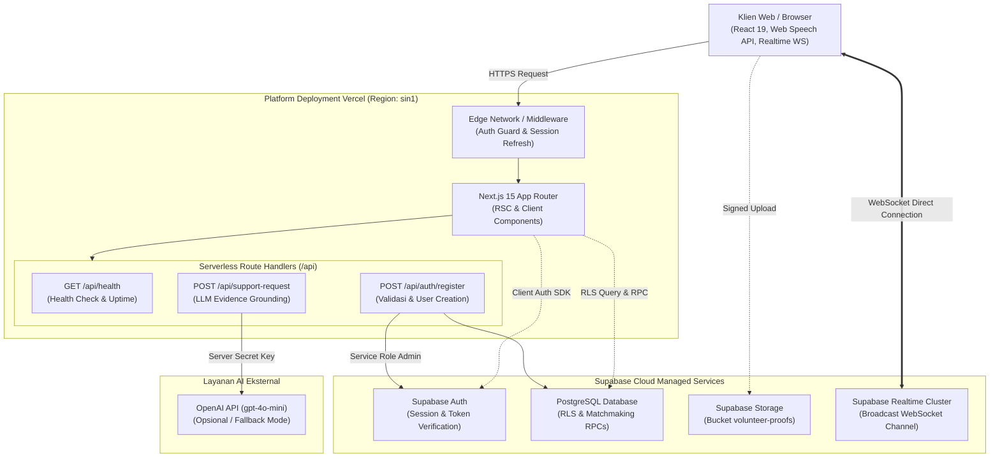

# hearme — Platform Peer Support Mahasiswa

**pilihan** → **voice AI interaktif** (cerita dengan suara) → ringkasan kebutuhan yang bisa dikoreksi →
**grup peer support** (3–4 orang, terstruktur) atau **1-on-1 dengan relawan approved** — dengan aturan
keselamatan, lapor, blokir, dan jalur bantuan.

> **Batas produk:** ini layanan dukungan sebaya, **bukan** diagnosis, terapi, atau pengganti tenaga profesional.

## ✨ Fitur Unggulan & Inovasi Utama

1. **🎙️ Percakapan Suara AI Alami (ChatGPT Voice-like Experience)**  
   Percakapan mengalir dua arah tanpa perlu menekan tombol opsi berulang kali: AI membacakan pertanyaan (TTS), pengguna menjawab dengan suara (STT), dan perpindahan pertanyaan dideteksi secara otomatis lewat jeda hening (*silence detection* ~1,4 detik). Dilengkapi *anti-echo* (mikrofon tertutup otomatis saat AI bersuara), visualisasi orb beranimasi, dan kemampuan menyela pembicaraan (*interruptible speech*).

2. **🕒 Konteks Waktu Nyata Adaptif (Time-Aware Greeting & Adaptive Intake)**  
   Salam di landing page serta pertanyaan pembuka Voice AI beradaptasi secara cerdas dengan jam aktual pengguna (Pagi, Siang, Sore, Malam) untuk menghadirkan atmosfer percakapan yang relevan, empatik, dan personal.

3. **🎨 Katarsis Menjadi Gema (Generative Flow-Field Art)**  
   Kata-kata curahan pengguna ditransformasikan secara deterministik menjadi karya seni abstrak visual (*Gema*) melalui HTML5 Canvas flow-field. Bersifat murni estetis dan terapeutik tanpa merekam data rahasia.

4. **🛡️ Moderasi Pesan Real-time (Automated Chat Safety Guard)**  
   Sensor kata kasar otomatis berbahasa Indonesia yang bekerja langsung di dalam ruang chat sesi untuk menyaring ujaran kebencian, pelecehan, atau kata tidak pantas secara real-time demi menjaga ekosistem dukungan sebaya yang aman.

5. **📚 Grounding Riset Jurnal Ilmiah (Evidence-Based Coping Suggestions)**  
   Analisis kebutuhan pengguna diperkuat oleh basis pengetahuan terstruktur dari jurnal ilmiah kesehatan mental mahasiswa, menghasilkan rekomendasi strategi koping (*coping suggestions*) berbasis bukti ilmiah pada ringkasan intake.

6. **🤝 Fleksibilitas Peer Support: Lingkaran Grup & 1-on-1 (Buat Manggil)**  
   Pengguna dapat memilih ruang kelompok (3–4 mahasiswa dengan kategori keresahan serupa) atau sesi privat berdua dengan relawan terakreditasi melalui sistem antrean otomatis dan fitur panggilan (*Buat Manggil*) di lobby relawan.

7. **🔒 Privasi Mutlak (Privacy-First & Zero Stored Transcripts)**  
   Pesan obrolan hanya dialirkan secara *ephemeral* via Supabase Realtime Broadcast tanpa ada transkrip rekaman yang disimpan di database. Satu-satunya data yang tersimpan hanyalah ringkasan kebutuhan yang dikonfirmasi pengguna.

8. **⚡ Smart Role-Based Gateway & Dedicated Admin Dashboard**  
   Pemisahan alur login otomatis: Akun Admin langsung masuk ke panel dashboard manajemen relawan dan operasional tanpa melewati alur suara AI, Relawan diarahkan ke formulir verifikasi atau lobby, dan Pengguna langsung masuk ke ruang bercerita.

## Alur baru (sesuai diagram role)

```
LOGIN / BIKIN AKUN → PILIHAN (Pengguna | Relawan | admin)
                       │
                       ├─ Pengguna → layar suara (voice ai, 3 pertanyaan) → [Selanjutnya] → gema & validasi kata
                       │                          │                                       │
                       │                          │                    GRUP ─→ MATCHMAKING ─→ USER 3-4 + RELAWAN 1
                       │                          │                    BY 1 ─→ MATCHMAKING ke RELAWAN ─┐
                       │                          │   (jalur merah baru: gema & validasi kata → langsung ke matchmaking)
                       │
                       ├─ Relawan → formulir + lampirkan 1 bukti kualifikasi → menunggu verif dari admin → LOBBY
                       │            → "muncul matchmaking dari user" → (Buat Manggil) → USER VS RELAWAN
                       │
                       └─ admin → dashboard
```

- **`/app/voice`** — **layar imersif setelah login** (tanpa header/nav): hanya AI yang tampil. Percakapan
  **mengalir seperti ChatGPT voice**: AI membacakan pertanyaan (TTS) dengan orb beranimasi, pengguna menjawab
  dengan suara (STT), dan **begitu pengguna selesai bicara AI langsung menanggapi lalu langsung membacakan
  pertanyaan berikutnya** — tanpa menekan mikrofon lagi. Tidak ada tombol opsi.
  - Akhir giliran dideteksi dari jeda hening (~1,4 dtk), bukan dari tombol.
  - Mikrofon **tidak pernah** terbuka selama AI bicara (mencegah AI mendengar suaranya sendiri).
  - Bisa **menyerobot bicara** (ketuk mikrofon saat AI bersuara) untuk memotong dan langsung menjawab.
  - Kalau suara gagal (izin ditolak / tidak terdengar), sebabnya ditampilkan dan ada input teks cadangan
    supaya pengguna tidak pernah terjebak.
  - Setelah **3 pertanyaan**, muncul tombol **Selanjutnya** yang bertransisi beranimasi ke fitur berikutnya.
- **`/app`** — fitur setelah suara: **Gema** dari kata-katamu + ringkasan yang bisa dikoreksi, lalu pilih jalur.
  Sengaja tidak terbuka dari awal — sebelum ada cerita, halaman ini hanya menampilkan ajakan mulai.
- **`/app/pilih`** — **pintu pertama setelah login**: pilih sebagai **Pengguna** atau **Relawan**.
  - **Pengguna** → langsung dibawa ke layar suara (`/app/voice`).
  - **Relawan** → langsung dibawa ke formulir pendaftaran (`/app/volunteer`); kalau sudah disetujui, ke lobby.
  - Admin melihat kartu tambahan ke dashboard.
- **`/app/lobby`** — lobby relawan: status siap, feed **"muncul matchmaking dari user"**, tombol **Panggil**
  (Buat Manggil) untuk 1-on-1, dan tawaran mendampingi grup yang berjalan.
- **`/app/queue`** — antrean user (grup / 1-on-1) + timeout dan opsi alternatif; otomatis lanjut kalau antrean
  masih menunggu atau relawan sudah memanggil.
- **`/app/session/[id]`** — ruang bicara: user mengonfirmasi dulu sebelum 1-on-1 dimulai (tidak ada
  perpindahan otomatis).

## Stack

- **Next.js 15** (App Router) + React 19 + Tailwind v4
- **Supabase** — Auth, Postgres + RLS, RPC matchmaking (semua transisi status di backend)
- Chat sesi via **Realtime Broadcast** (ephemeral, **tanpa transkrip tersimpan**)

## Setup (5 langkah)

1. **Buat project Supabase** di https://supabase.com/dashboard.
2. **Jalankan schema**: buka *SQL Editor* → tempel seluruh isi [`supabase/schema.sql`](./supabase/schema.sql) → Run.
   (Aman dijalankan berulang.) Schema ini juga membuat bucket privat **`volunteer-proofs`** untuk bukti
   kualifikasi relawan — kalau sudah pernah menjalankan schema sebelumnya, jalankan ulang agar bucket & kolom
   `proof_type`/`proof_path` ikut terpasang.
3. **Isi kredensial**: salin `.env.local.example` → `.env.local`, lalu isi dari
   *Project Settings → API keys*: `NEXT_PUBLIC_SUPABASE_URL` + kunci **publik** kamu, dan
   `SUPABASE_SERVICE_ROLE_KEY` (kunci rahasia — hanya untuk seed/API server, jangan pernah diekspos ke browser).
   Kunci publik boleh ditulis di salah satu nama: `NEXT_PUBLIC_SUPABASE_PUBLISHABLE_KEY` (`sb_publishable_…`,
   nama di dashboard baru) atau `NEXT_PUBLIC_SUPABASE_ANON_KEY` (`eyJ…`, nama lama). Aplikasi membaca keduanya.
4. **Matikan konfirmasi email** (khusus demo): *Authentication → Sign In / Providers → Email* → matikan
   “Confirm email”. (Atau konfirmasi manual dari email.)
5. **Install & seed**:
   ```bash
   npm install
   npm run seed   # membuat akun demo + menyetujui relawan demo
   npm run dev
   ```

## Akun demo (dari `npm run seed`)

| Email | Peran | Catatan |
|---|---|---|
| `user@demo.local` | Pengguna | pengguna biasa |
| `relawan@demo.local` | Relawan | sudah `approved`, tinggal set “Siap menerima sesi” |
| `admin@demo.local` | Admin | panel admin |

Password semua akun demo: `DemoHearme123!` — **ganti sebelum dipakai publik**.

## Alur demo di panggung (≈4 menit)

1. **1-on-1 (Buat Manggil)** — Login `relawan@demo.local` (jendela 1) → **Lobby** → set *Siap menerima sesi*.
   Login `user@demo.local` (jendela 2) → **pilihan** → klik **Pengguna** → ketuk *Mulai mengobrol* → jawab
   **3 pertanyaan dengan suara** (AI langsung menanggapi tiap jawaban dan melanjutkan sendiri) → **Selanjutnya**
   (transisi beranimasi) → ringkasan bisa dikoreksi → pilih **1-on-1**.
   Di lobby relawan muncul permintaan itu → klik **Panggil** → user mengonfirmasi → ngobrol → **Akhiri sesi** → check-in.
2. **Grup** — Panel admin → **Konfigurasi** → `group_target_members = 2` (biar cepat).
   Dua akun pengguna masuk antrean grup kategori sama → grup terbentuk otomatis.
3. **Keselamatan** — Saat menulis indikasi risiko langsung, muncul **banner jalur bantuan** (bukan sekadar matchmaking).
   Di dalam sesi: tombol **Laporkan** (kategori alasan) dan **Blokir**; admin meninjau di panel.
4. **Relawan gabung grup** — Di lobby, relawan klik *Tawarkan diri mendampingi* pada grup aktif → peserta diberi
   pilihan **setuju/tolak** dengan batas waktu (default 30 detik). Semua setuju → sesi jadi terapi grup; ditolak →
   tetap grup peer support.
5. **Timeout** — Biarkan antrean 1-on-1 lewat batas waktu (default 3 menit, ubah di panel admin) → muncul opsi:
   tetap menunggu / masuk grup / kembali ke AI / sumber bantuan.

## Peta implementasi (P0 §12 dokumen)

| P0 | Implementasi |
|---|---|
| Login/akun demo | Supabase Auth + `scripts/seed.mjs` |
| Pilihan jalur (pilihan) | `/app/pilih` — **pintu pertama setelah login**: Pengguna → voice AI, Relawan → formulir pendaftaran. **Admin tidak lewat sini** — langsung dialihkan ke dashboard |
| AI chat/voice sederhana | `/app/voice` — percakapan mengalir (gaya ChatGPT voice): AI membacakan pertanyaan (TTS) + orb beranimasi, pengguna menjawab dengan suara (STT, Web Speech API), AI langsung menanggapi & melanjutkan; endpointing dari jeda hening, mikrofon tidak pernah terbuka saat AI bicara |
| Ringkasan bisa dikoreksi | `/app` — setelah tombol **Selanjutnya**: Gema + edit teks, kategori, bahasa |
| Pilihan grup vs 1-on-1 | `/app` langkah pilih jalur; tidak ada perpindahan otomatis |
| Formulir pendaftaran relawan | `/app/volunteer` — formulir + **wajib lampirkan 1 bukti kualifikasi** (STR / ijazah psikologi / sertifikat / surat kampus) → menunggu verif admin |
| Bukti kualifikasi relawan | Storage privat `volunteer-proofs` (1 berkas per pendaftar, maks 5 MB, JPG/PNG/WEBP/PDF); admin membukanya lewat **signed URL** di `/app/admin` |
| Admin approve/reject | `/app/admin` — **dashboard operasional**: angka utama (relawan aktif, sesi berjalan, pendaftar menunggu, laporan terbuka), daftar pendaftar + lihat bukti, laporan, konfigurasi demo. Navigasi admin terpisah dari menu pengguna/relawan |
| Lobby relawan | `/app/lobby` — "muncul matchmaking dari user" + **Buat Manggil** (`volunteer_claim_request`) |
| Matchmaking 1-on-1 | RPC `poll_one_to_one_queue` (reservasi, ring 30 dtk) **dan** klaim dari lobby; user konfirmasi (`confirm_member_consent`) |
| Grup + aturan + panduan sesi | RPC `poll_group_queue`; panduan pembukaan/berbagi/penutup di ruang sesi |
| Timeout antrean + opsi alternatif | Halaman `/app/queue` |
| Tombol keluar & lapor | `SafetyActions` (lapor/blokir/keluar) + `leave_session` |
| Check-in setelah sesi | `submit_checkin` (mood + catatan, opsional) |

## Arsitektur Deployment & Alur Data

Hearme menggunakan arsitektur **Monolith Serverless (Unified Next.js 15 App Router)** yang di-deploy ke Vercel (Edge & Serverless Functions di region Singapore `sin1`) dan terhubung ke **Supabase Cloud** sebagai backend data persisten, autentikasi, serta kluster WebSocket realtime.



### Mengapa Arsitektur Ini Tepat & Optimal untuk Vercel?
1. **Zero Cold-Start Overhead**: Tidak membutuhkan container runtime terpisah (Express/FastAPI/Docker). Semua endpoint berupa Next.js Serverless Route Handlers yang di-scale otomatis oleh Vercel.
2. **Solusi WebSocket Serverless**: Vercel Serverless Functions bersifat stateless dan tidak ditujukan untuk koneksi WebSocket persisten jangka panjang.Hearme mengatasi ini secara elegan dengan mengarahkan koneksi WebSocket realtime langsung dari browser klien ke kluster **Supabase Realtime (Elixir Phoenix Channels)**, sehingga komunikasi chat antar-mahasiswa berjalan instan tanpa membebani runtime Vercel.
3. **Keamanan Kredensial (Zero-Leak)**:
   - Secret rahasia (`SUPABASE_SERVICE_ROLE_KEY` dan `OPENAI_API_KEY`) hanya diakses di sisi server (`src/app/api/...` dan `src/lib/supabase/server.js`).
   - Browser klien hanya menerima kredensial publik (`NEXT_PUBLIC_SUPABASE_URL` dan `NEXT_PUBLIC_SUPABASE_PUBLISHABLE_KEY`) yang dilindungi penuh oleh aturan **Row Level Security (RLS)** PostgreSQL.
4. **Optimalisasi Latensi (Region Singapore `sin1`)**: Melalui `vercel.json`, fungsi serverless ditempatkan pada region terdekat dengan pengguna Indonesia (`sin1`), memangkas latensi dari ~220ms (US) menjadi ~20ms.

---

## Struktur Folder & File Kunci

```
├── .env.example                  # Template konfigurasi environment standar (Vercel & lokal)
├── .env.local.example            # Salinan template lokal beranotasi lengkap
├── vercel.json                   # Konfigurasi deployment Vercel (Region sin1)
├── next.config.mjs               # Konfigurasi Next.js 15 & Security Headers (CSP, Permissions Policy)
├── scripts/
│   ├── test-deployment.mjs       # Test suite integrasi deployment (npm test)
│   ├── seed.mjs                  # Akun demo via service role admin
│   └── build-journal-knowledge.mjs # Generator basis pengetahuan jurnal ilmiah
├── supabase/
│   └── schema.sql                # Skema PostgreSQL + RLS + RPC Matchmaking & Consent
└── src/
    ├── middleware.js             # Edge Auth & Session Guard (kompatibel Next.js 15 Proxy)
    ├── app/
    │   ├── api/
    │   │   ├── health/route.js         # Endpoint health check & monitoring (/api/health)
    │   │   ├── auth/register/route.js  # Serverless Handler pendaftaran aman dengan rate-limit
    │   │   └── support-request/route.js # Serverless Handler analisis kebutuhan AI & jurnal ilmiah
    │   ├── app/
    │   │   ├── voice/page.js     # Percakapan suara imersif (TTS + STT adaptif waktu)
    │   │   ├── page.js           # Gema visual generatif & ringkasan yang bisa dikoreksi
    │   │   ├── pilih/page.js     # Pintu pertama pasca-login (Pengguna vs Relawan)
    │   │   ├── lobby/page.js     # Lobby relawan: ketersediaan & Buat Manggil
    │   │   ├── queue/page.js     # Antrean matchmaking grup / 1-on-1 + timeout
    │   │   ├── session/[sessionId]/page.js # Ruang chat realtime + sensor moderasi otomatis
    │   │   ├── volunteer/page.js # Formulir relawan + upload bukti kualifikasi
    │   │   ├── account/page.js   # Pengaturan profil akun pengguna
    │   │   └── admin/page.js     # Dashboard admin operasional & verifikasi relawan
    │   ├── login/page.js         # Halaman autentikasi login
    │   ├── register/page.js      # Halaman pendaftaran pengguna
    │   └── page.js               # Editorial landing page (salam adaptif jam nyata)
    └── lib/
        ├── time.js               # Helper deteksi sapaan waktu aktual (Pagi/Siang/Sore/Malam)
        ├── moderation.js         # Sensor moderasi kata kasar otomatis (Bahasa Indonesia)
        ├── voice.js              # State machine Web Speech API & audio lock
        ├── intake.js             # Pertanyaan intake terstruktur & parser kebutuhan
        └── supabase/
            ├── client.js         # Browser Supabase client (@supabase/ssr)
            ├── server.js         # Server & Admin Supabase client (@supabase/ssr)
            └── env.js            # Validasi kredensial environment Supabase
```

---

## Panduan Deployment Vercel & GitHub CI/CD

Platform Hearme terintegrasi secara otomatis dengan alur Git di Vercel:
- **Production Deployment**: Otomatis ter-deploy ke domain produksi setiap kali ada `git push` ke branch utama (`main`).
- **Preview Deployment**: Setiap Pull Request (PR) atau branch pengembangan baru otomatis dibuatkan link preview terisolasi untuk pengujian sebelum digabung ke `main`.

### Langkah Konfigurasi Environment Variables di Vercel Dashboard:
Buka **Vercel Dashboard** → Pilih Project **Hearme** → **Settings** → **Environment Variables**, lalu tambahkan:

| Nama Variabel | Lingkungan (Environment) | Deskripsi |
| :--- | :--- | :--- |
| `NEXT_PUBLIC_SUPABASE_URL` | Production, Preview, Development | URL Project Supabase (`https://your-id.supabase.co`) |
| `NEXT_PUBLIC_SUPABASE_PUBLISHABLE_KEY` | Production, Preview, Development | Publishable Key (`sb_publishable_...`) atau Anon Key (`eyJ...`) |
| `SUPABASE_SERVICE_ROLE_KEY` | Production, Preview, Development | Service Role Key rahasia (hanya server / bypass RLS) |
| `OPENAI_API_KEY` | Production, Preview, Development | *(Opsional)* API Key OpenAI untuk grounding ilmiah LLM |
| `OPENAI_MODEL` | Production, Preview, Development | *(Opsional)* Default: `gpt-4o-mini` |

> [!IMPORTANT]
> Di **Supabase Dashboard** (*Authentication -> URL Configuration*):
> Pastikan **Site URL** diisi domain Vercel Anda (misal `https://hearme.vercel.app`), dan tambahkan `https://*-your-team.vercel.app/**` ke **Redirect URLs** agar login pada Preview Deployment berjalan mulus.

---

## Pengujian & Verifikasi Lokal

Sebelum melakukan push atau deploy, pastikan seluruh pengujian integrasi lolos:

```bash
# 1. Jalankan test suite integrasi deployment
npm test

# 2. Jalankan build Next.js lokal
npm run build
```

---

## Keputusan Desain Penting (Sesuai Dokumen)

- **Tidak ada transkrip tersimpan** — pesan hanya lewat Realtime Broadcast. Yang tersimpan hanya ringkasan
  kebutuhan yang *dikonfirmasi pengguna* (`support_requests.needs_summary`).
- **Moderasi Otomatis Terpasang** — pesan chat otomatis disaring dan disensor secara real-time demi menjaga ruang aman bagi seluruh mahasiswa.
- **Admin tidak punya akses default ke percakapan**; RLS membatasi. Admin hanya melihat laporan & agregat.
- **Semua transisi status di backend** (RPC `SECURITY DEFINER`), bukan hanya di UI.
- **Relawan `approved` saja** yang bisa `available` (dicek trigger, bukan cuma UI).
- **Relawan telat di grup tidak masuk otomatis** — butuh persetujuan semua peserta (batas waktu configurable).
- **Angka 3 menit / kuota grup / durasi fase = konfigurasi** (`app_config`), bukan aturan universal.

## Konfigurasi operasional (`app_config`, bisa diubah dari panel admin)

| Key | Default | Arti |
|---|---|---|
| `group_target_members` | 3 | kuota pembentukan grup (turunkan ke 2 untuk demo) |
| `group_max_members` | 5 | maksimum termasuk relawan |
| `group_wait_minutes` | 5 | batas tunggu grup |
| `one_to_one_wait_minutes` | 3 | batas pencarian relawan |
| `one_to_one_ring_seconds` | 30 | waktu relawan menjawab tawaran |
| `volunteer_join_consent_seconds` | 30 | waktu peserta menyetujui relawan gabung |
| `session_durations` | 5/25/10 | menit fase pembukaan/berbagi/penutup |

## Pertanyaan terbuka tim (§15 dokumen) — rekomendasi implementasi saat ini

- Grup tanpa relawan **boleh berjalan** (dianggap layanan tersendiri, bukan ruang tunggu relawan).
- 3 menit = **batas pencarian relawan** (per request, bukan total).
- Grup mulai saat **kuota terpenuhi** (jadwal menyusul di P1).
- Sesi tatap muka **belum** ada — perlu aturan lokasi & keselamatan terpisah.
- Rujukan profesional masih placeholder di `/app/account#bantuan` — ganti dengan kontak kampus yang terverifikasi.

## Deploy

Vercel: import repo, set env vars yang sama seperti `.env.local`, deploy.
Pastikan **Site URL** Supabase diarahkan ke domain Vercel untuk redirect auth.

## Standar Commit & Kontribusi

Proyek ini menggunakan format standar **[Conventional Commits v1.0.0](https://www.conventionalcommits.org/)**.  
Panduan lengkap tipe commit, cakupan (*scope*), dan aturan branch dapat dibaca di:
👉 **[`COMMIT_CONVENTION.md`](./COMMIT_CONVENTION.md)**

Untuk mengaktifkan template commit otomatis di Git lokal Anda:
```bash
git config commit.template .gitmessage
```
